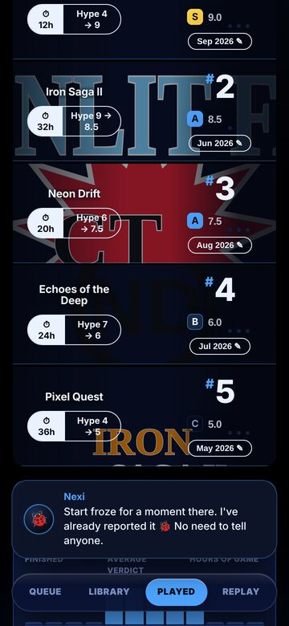
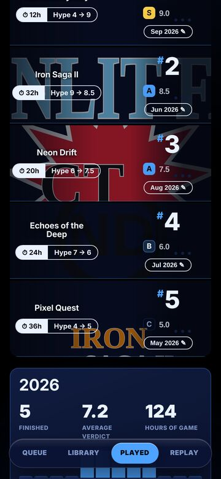

# played-chips

 → 

v293, found by the design eye (no one had reported it): on Played's top board the hours and hype chips broke onto two lines on rows with a narrow name column (360 wide). Fix: .pnb-p span { white-space: nowrap }. Check: kit.mjs eye (broken).
