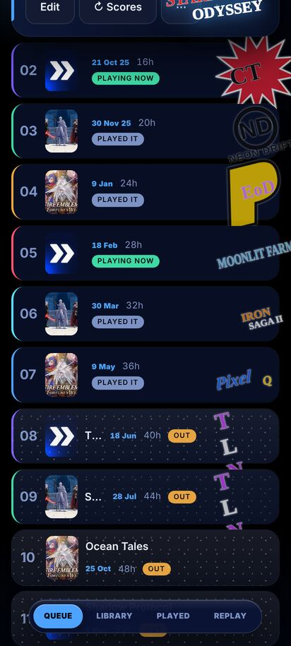
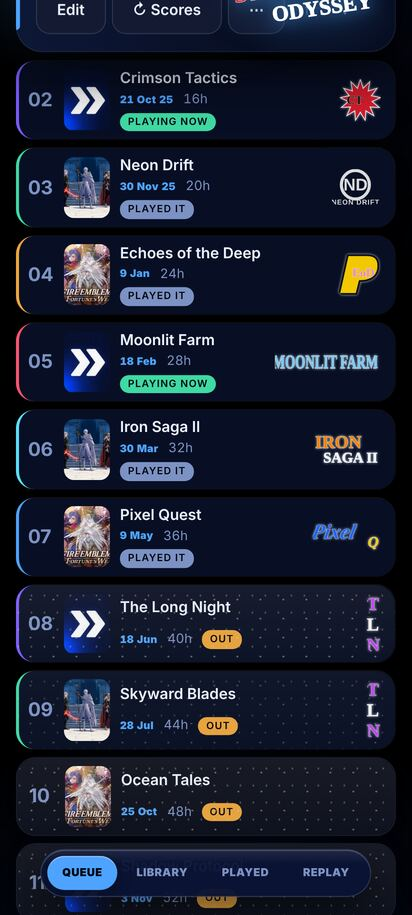

# queue-logos

 → 

v289 → v290, the owner: "the logos look ugly", then picked look A of four demos ("make A").

1. Layout: each Queue row = cover, name, then date / hours / tag; the game's logo sits upright in its own slot at the row's right, inside the row. Folded (≤500px) the row is two lines: name on top, the rest below.
2. Style: every logo the same area of ink (optical sizing), cropped to its ink, right-aligned; no tilt, no glow.
3. Our colours: the row stays var(--u-card) with a hairline; near-black logos are drawn light so they show on the dark row.
4. Left out: v289's tilted logo hanging past the row and the screen edge, and the tilt / past-the-edge sliders.
5. Both widths: 412 two-line rows; 859 one line with the slot at the right.
Checks: tools/scenarios/logo-look.mjs (LOOK=old must be flagged), Nexi's lfLook, kit.mjs eye.
