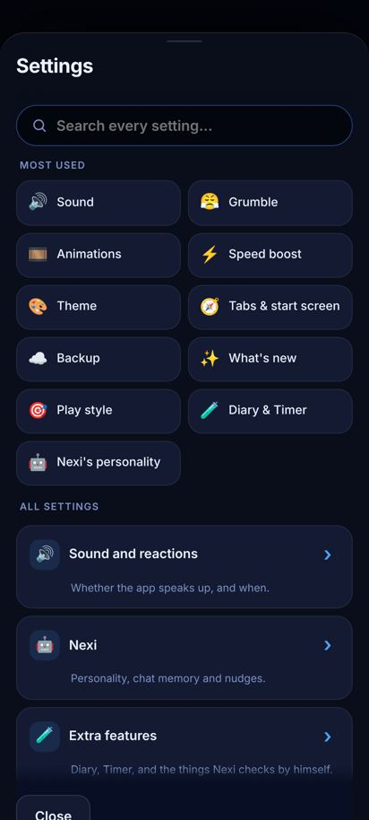
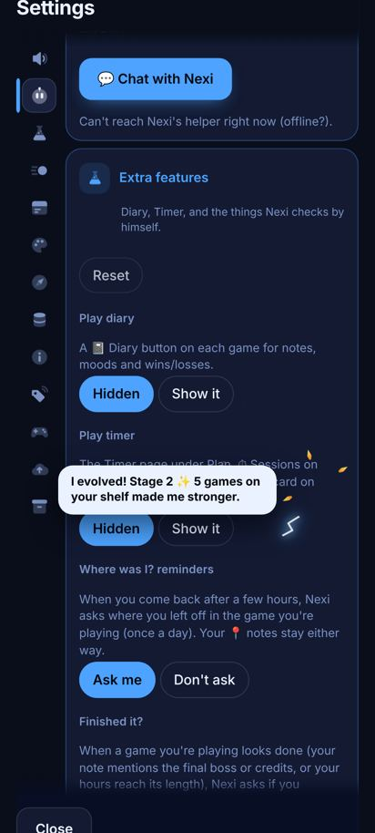

# settings-rail

 → 

Layout: Settings went from a list of group rows that each open their own page to one scroll of open groups with a sticky column of group icons on the left. Style: 38px icon tiles, a 4px blue bar beside the lit one, a lit tile (raised card + hairline), the name popping out in a pill with a blue edge. Our colours: --u-card2 tile, var(--volt) bar, var(--mute) idle icons, var(--ice) lit. Left out: the demo's emoji (the owner hates them: drawn v247-style icons instead), any press effect. Both widths: 44px rail folded (groups keep ~320px), same rail unfolded.
